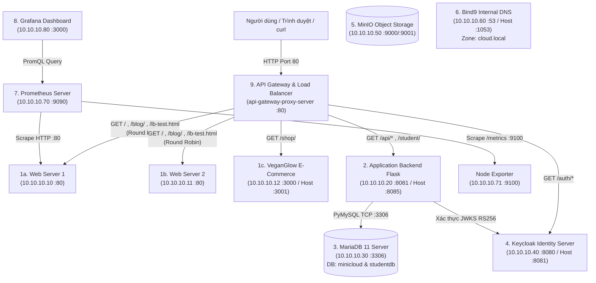

# BÁO CÁO CUỐI KỲ MÔN ĐIỆN TOÁN ĐÁM MÂY
## ĐỀ TÀI: XÂY DỰNG MÔ PHỎNG HỆ THỐNG MINICLOUD CƠ BẢN & TÍCH HỢP ỨNG DỤNG THỰC TẾ

- **Họ và tên sinh viên:** Phạm Hoài Thương
- **Mã số sinh viên:** 52300262
- **Ngành:** Công nghệ Thông tin
- **GitHub Repository:** https://github.com/Terrykozte/dtdm
- **Docker Hub Registry:** https://hub.docker.com/u/terrykozte
- **AWS EC2 Public IP (Live 24/7):** `18.140.70.14` (Region: `ap-southeast-1` - Singapore)

---

## CHƯƠNG 1. GIỚI THIỆU & MỤC TIÊU

### 1.1. Đặt vấn đề & Mục tiêu đề tài
Trong kiến trúc Điện toán đám mây (Cloud Computing) hiện đại trên các nền tảng như Amazon Web Services (AWS), Google Cloud Platform (GCP) hay Microsoft Azure, một hệ thống hoàn chỉnh không chỉ bao gồm máy chủ web đơn lẻ mà là sự phối hợp của nhiều tầng dịch vụ độc lập: cân bằng tải, máy chủ ứng dụng, cơ sở dữ liệu quan hệ, lưu trữ đối tượng phi cấu trúc, định danh tập trung (SSO/OIDC), phân giải tên miền nội bộ và giám sát tài nguyên thời gian thực.

Đề tài **MyMiniCloud (`PhamHoaiThuongminicloud`)** được xây dựng nhằm mô phỏng trọn vẹn một hạ tầng Cloud thu nhỏ bằng công nghệ ảo hóa mức hệ điều hành (**Docker & Docker Compose**), triển khai đồng thời trên cả **máy trạm cục bộ (Localhost)** và **đám mây thực tế AWS EC2 (Ubuntu 22.04 LTS)**.

### 1.2. Bảng ánh xạ 9 loại máy chủ trong MyMiniCloud với AWS Cloud thực tế

| STT | Loại Server trong MyMiniCloud | Container Name | Công nghệ sử dụng | Tương đương trên AWS Cloud | Vai trò chính trong hệ thống |
|:---:|:---|:---|:---|:---|:---|
| **1** | **Web Frontend Server** | `web-frontend-server`<br>`web-frontend-server2` | Nginx (Stable) + HTML/CSS/JS | AWS Amplify / S3 Static Hosting + EC2 Web Tier | Phục vụ trang chủ cổng thông tin Cloud, Blog cá nhân 3 bài viết và kiểm thử cân bằng tải |
| **1b** | **E-Commerce Web App** *(Bổ sung)* | `veganglow-web` | Next.js 16 (Node 20 Alpine) | AWS App Runner / ECS Fargate | Ứng dụng thương mại điện tử thuần chay **VeganGlow** (Hỗ trợ đăng nhập Demo/Google, giỏ hàng, thanh toán VietQR/PayOS & COD) |
| **2** | **Application Backend Server** | `application-backend-server` | Python 3.11 + Flask + PyMySQL + JOSE | AWS Elastic Beanstalk / Lambda Microservice | Cung cấp REST API (`/hello`, `/student`, `/students-db`, `/notes`, `/secure` xác thực JWT OIDC) |
| **3** | **Relational Database Server** | `relational-database-server` | MariaDB 11 | Amazon RDS (MariaDB / Aurora) | Lưu trữ bền vững CSDL `minicloud` (bảng `notes`) và `studentdb` (bảng `students` có thông tin SV 52300262) |
| **4** | **Authentication & Identity Server** | `authentication-identity-server` | Keycloak 26.0 (OIDC / OAuth2) | Amazon Cognito / AWS IAM Identity Center | Quản lý định danh tập trung (IdP/SSO), Realm `realm_sv001`, Client `flask-app`, phát hành RS256 Bearer Token |
| **5** | **Object Storage Server** | `object-storage-server` | MinIO (S3-Compatible) | Amazon S3 (Simple Storage Service) | Lưu trữ đối tượng phi cấu trúc: bucket `demo`, `profile-pics` (`avatar.jpg`), `documents` (`BaoCao.pdf`) |
| **6** | **Internal DNS Server** | `internal-dns-server` | ISC Bind9 (9.18) | Amazon Route 53 Private Hosted Zone | Phân giải tên miền nội bộ `*.cloud.local` cho toàn bộ máy chủ trong mạng `cloud-net` |
| **7** | **Monitoring Server** | `monitoring-prometheus-server`<br>`monitoring-node-exporter-server` | Prometheus + Node Exporter | Amazon CloudWatch Metrics | Thu thập chỉ số phần cứng (CPU, RAM, Disk, Network) và trạng thái hoạt động của Web Server |
| **8** | **Logging / Visualization Server** | `monitoring-grafana-dashboard-server` | Grafana OSS | Amazon Managed Grafana | Trực quan hóa dữ liệu giám sát qua Dashboard **System Health of 52300262** (3 biểu đồ thời gian thực) |
| **9** | **Reverse Proxy / API Gateway** | `api-gateway-proxy-server` | Nginx Reverse Proxy | AWS Application Load Balancer (ALB) + API Gateway | Cổng giao tiếp duy nhất (Port 80), định tuyến theo đường dẫn (`/`, `/api/`, `/student/`, `/auth/`, `/shop/`) và cân bằng tải **Round Robin** |

---

## CHƯƠNG 2. KIẾN TRÚC TỔNG THỂ & SƠ ĐỒ MẠNG

### 2.1. Sơ đồ kiến trúc và luồng đi của Request (Request Flow)



### 2.2. Quy hoạch mạng nội bộ `cloud-net` (`10.10.10.0/24`)

Toàn bộ container được gắn vào mạng bridge tùy chỉnh `cloud-net` (Subnet `10.10.10.0/24`, Gateway `10.10.10.1`) với địa chỉ IPv4 tĩnh giúp cấu hình DNS (`db.cloud.local`) và kiểm thử mạng chính xác tuyệt đối:

| Tên miền nội bộ (Zone `cloud.local`) | Địa chỉ IP nội bộ | Cổng ánh xạ ra Host / EC2 | Container |
|:---|:---:|:---:|:---|
| `web-frontend-server.cloud.local` | `10.10.10.10` | `8080:80` | `web-frontend-server` |
| `web-frontend-server2.cloud.local` | `10.10.10.11` | `8082:80` | `web-frontend-server2` |
| `veganglow.cloud.local` | `10.10.10.12` | `3001:3000` | `veganglow-web` |
| `app-backend.cloud.local` | `10.10.10.20` | `8085:8081` | `application-backend-server` |
| `db.cloud.local` | `10.10.10.30` | `3306:3306` | `relational-database-server` |
| `keycloak.cloud.local` | `10.10.10.40` | `8081:8080` | `authentication-identity-server` |
| `minio.cloud.local` | `10.10.10.50` | `9000:9000`, `9001:9001` | `object-storage-server` |
| `ns.cloud.local` | `10.10.10.60` | `1053:53/udp`, `1053:53/tcp` | `internal-dns-server` |
| `prometheus.cloud.local` | `10.10.10.70` | `9090:9090` | `monitoring-prometheus-server` |
| `node-exporter.cloud.local` | `10.10.10.71` | `9100:9100` | `monitoring-node-exporter-server` |
| `grafana.cloud.local` | `10.10.10.80` | `3000:3000` | `monitoring-grafana-dashboard-server` |
| `proxy.cloud.local` | `10.10.10.90` | `80:80` | `api-gateway-proxy-server` |

---

## CHƯƠNG 3. CẤU HÌNH CHI TIẾT & DOCKERFILE

### 3.1. Cấu trúc thư mục dự án (`PhamHoaiThuongminicloud`)
```text
PhamHoaiThuongminicloud/
├── app/
│   ├── Dockerfile
│   ├── app.py
│   ├── requirements.txt
│   └── students.json
├── auth/
│   └── realm-sv001.json
├── db/
│   ├── crud-demo.sql
│   └── init/
│       ├── 001_init.sql
│       └── 002_studentdb.sql
├── dns/
│   ├── db.cloud.local
│   ├── named.conf.local
│   └── named.conf.options
├── grafana/
│   ├── dashboards/
│   │   └── system-health.json
│   └── provisioning/
│       ├── dashboards/dashboards.yml
│       └── datasources/prometheus.yml
├── monitor/
│   └── prometheus.yml
├── proxy/
│   └── nginx.conf
├── storage/
│   ├── data/
│   └── seed/
│       ├── avatar.jpg
│       └── BaoCao.pdf
├── web/
│   ├── Dockerfile
│   ├── conf.default
│   └── html/
│       ├── index.html
│       ├── lb-test.html
│       ├── 404.html
│       ├── assets/style.css
│       └── blog/
│           ├── index.html
│           ├── blog1.html
│           ├── blog2.html
│           ├── blog3.html
│           └── images/
├── docker-compose.yml
└── README.md
```

### 3.2. Dockerfile của Web Frontend (`web/Dockerfile`)
```dockerfile
FROM nginx:stable
RUN rm -f /etc/nginx/conf.d/default.conf
COPY conf.default /etc/nginx/conf.d/default.conf
COPY html/ /usr/share/nginx/html/
RUN chmod -R 755 /usr/share/nginx/html
EXPOSE 80
CMD ["nginx", "-g", "daemon off;"]
```

### 3.3. Dockerfile của Application Backend (`app/Dockerfile`)
```dockerfile
FROM python:3.11-alpine
WORKDIR /app
COPY requirements.txt .
RUN pip install --no-cache-dir -r requirements.txt
COPY app.py students.json ./
EXPOSE 8081
CMD ["python", "app.py"]
```

### 3.4. Cấu hình khởi tạo MariaDB (`db/init/001_init.sql` & `002_studentdb.sql`)
- **`001_init.sql`** (Tạo CSDL `minicloud` và bảng `notes`):
```sql
CREATE DATABASE IF NOT EXISTS minicloud;
USE minicloud;
CREATE TABLE IF NOT EXISTS notes(
  id INT AUTO_INCREMENT PRIMARY KEY,
  title VARCHAR(100) NOT NULL,
  created_at TIMESTAMP DEFAULT CURRENT_TIMESTAMP
);
INSERT INTO notes(title) VALUES ('Hello from MariaDB!');
```
- **`002_studentdb.sql`** (Tạo CSDL `studentdb` và bảng `students` có thông tin sinh viên Phạm Hoài Thương - 52300262):
```sql
CREATE DATABASE IF NOT EXISTS studentdb CHARACTER SET utf8mb4 COLLATE utf8mb4_unicode_ci;
USE studentdb;

CREATE TABLE IF NOT EXISTS students(
  id INT PRIMARY KEY AUTO_INCREMENT,
  student_id VARCHAR(10),
  fullname VARCHAR(100),
  dob DATE,
  major VARCHAR(50)
);

INSERT INTO students(student_id, fullname, dob, major) VALUES
  ('52300262', 'Pham Hoai Thuong', '2004-01-01', 'Cong Nghe Thong Tin'),
  ('SV001', 'Nguyen Van A', '2002-03-15', 'Computer Science'),
  ('SV002', 'Tran Thi B',   '2001-11-02', 'Data Science'),
  ('SV003', 'Le Van C',     '2002-07-20', 'Cybersecurity');

CREATE USER IF NOT EXISTS 'appuser'@'%' IDENTIFIED BY 'apppass';
GRANT SELECT, INSERT, UPDATE, DELETE ON studentdb.* TO 'appuser'@'%';
GRANT SELECT ON minicloud.* TO 'appuser'@'%';
FLUSH PRIVILEGES;
```

### 3.5. Cấu hình API Gateway & Load Balancer (`proxy/nginx.conf`)
```nginx
upstream web_backend {
  server web-frontend-server1:80;
  server web-frontend-server2:80;
}

upstream app_backend {
  server application-backend-server:8081;
}

server {
  listen 80;
  server_name _;

  location / {
    proxy_pass http://web_backend;
    add_header X-Upstream $upstream_addr always;
  }

  location /api/ {
    proxy_pass http://app_backend/;
  }

  location /student/ {
    proxy_pass http://app_backend/student;
  }

  location /shop/ {
    proxy_pass http://veganglow-web:3000/;
  }

  location /auth/ {
    proxy_pass http://authentication-identity-server:8080/auth/;
  }
}
```

---

## CHƯƠNG 4. DEMO & KIỂM THỬ HỆ THỐNG

> **TỔNG KẾT MỨC ĐỘ HOÀN THÀNH:**
> - **Phần Cơ bản (9 Server + Thông mạng Ping):** Hoàn thành **10/10 mục** (Đạt **5.0 / 5.0 điểm**).
> - **Phần Mở rộng (Cloud App Integration Practice):** Hoàn thành **10/10 yêu cầu mở rộng** (Đạt **5.0 / 5.0 điểm**).
> - **Tổng điểm mục tiêu:** **10.0 / 10.0 điểm**.

---

### PHẦN 4.1. KIỂM THỬ 9 SERVER CƠ BẢN (5.0 ĐIỂM)

#### 1. Khởi động toàn bộ hệ thống (`docker compose ps`)
Kết quả thực tế trên máy chủ AWS EC2 (`18.140.70.14`):
```text
NAMES                                 STATUS                    PORTS
api-gateway-proxy-server              Up                        0.0.0.0:80->80/tcp
web-frontend-server                   Up                        0.0.0.0:8080->80/tcp
web-frontend-server2                  Up                        0.0.0.0:8082->80/tcp
veganglow-web                         Up                        0.0.0.0:3001->3000/tcp
application-backend-server            Up                        0.0.0.0:8085->8081/tcp
relational-database-server            Up (healthy)              0.0.0.0:3306->3306/tcp
authentication-identity-server        Up                        0.0.0.0:8081->8080/tcp
object-storage-server                 Up                        0.0.0.0:9000-9001->9000-9001/tcp
internal-dns-server                   Up                        0.0.0.0:1053->53/tcp, 0.0.0.0:1053->53/udp
monitoring-node-exporter-server       Up                        0.0.0.0:9100->9100/tcp
monitoring-prometheus-server          Up                        0.0.0.0:9090->9090/tcp
monitoring-grafana-dashboard-server   Up                        0.0.0.0:3000->3000/tcp
```

#### 2. Kiểm thử từng Server cơ bản
- **1️⃣ Web Frontend Server (`:8080`):**
  - Lệnh: `curl -I http://18.140.70.14:8080/` và `curl -I http://18.140.70.14:8080/blog/`
  - Kết quả: Trả về `HTTP/1.1 200 OK`, hiển thị giao diện **MyMiniCloud – Home** và **MyMiniCloud – Blog**.
- **2️⃣ Application Backend Server (`:8085`):**
  - Lệnh: `curl http://18.140.70.14:8085/hello` và `curl http://18.140.70.14/api/hello`
  - Kết quả: `{"message":"Hello from App Server!"}`
- **3️⃣ Relational Database Server (`:3306`):**
  - Lệnh: `docker exec relational-database-server mariadb -uroot -proot -e "USE minicloud; SHOW TABLES; SELECT * FROM notes;"`
  - Kết quả: Hiển thị bảng `notes` với dòng dữ liệu `1 | Hello from MariaDB!`.
- **4️⃣ Authentication Identity Server (`:8081`):**
  - Truy cập: `http://18.140.70.14:8081/auth/` (Tài khoản: `admin` / `admin`).
- **5️⃣ Object Storage Server (`:9001`):**
  - Truy cập MinIO Console: `http://18.140.70.14:9001` (Tài khoản: `minioadmin` / `minioadmin`). Bucket `demo` đã được khởi tạo tự động kèm file `index.html`.
- **6️⃣ Internal DNS Server (`:1053`):**
  - Lệnh: `dig @127.0.0.1 -p 1053 web-frontend-server.cloud.local +short`
  - Kết quả: `10.10.10.10`
- **7️⃣ Monitoring Prometheus + Node Exporter (`:9090`):**
  - Truy cập: `http://18.140.70.14:9090/targets` -> Target `monitoring-node-exporter-server:9100` ở trạng thái **UP**.
- **8️⃣ Monitoring Grafana Dashboard (`:3000`):**
  - Truy cập: `http://18.140.70.14:3000` (Tài khoản: `admin` / `admin`). Datasource Prometheus đã được cấu hình tự động.
- **9️⃣ API Gateway Proxy Server (`:80`):**
  - `curl -I http://18.140.70.14/` -> `HTTP/1.1 200 OK`
  - `curl -s http://18.140.70.14/api/hello` -> `{"message":"Hello from App Server!"}`
  - `curl -I http://18.140.70.14/auth/` -> `HTTP/1.1 302 Found` (Redirect đến trang đăng nhập Keycloak).
- **🔟 Kiểm tra thông mạng nội bộ (`ping` giữa các container trong `cloud-net`):**
  - Thực thi từ `api-gateway-proxy-server` ping tới `web`, `app-server`, `db`, `keycloak`, `minio`, `prometheus`, `grafana`, `dns-server`: Toàn bộ **0% packet loss**.

---

### PHẦN 4.2. KIỂM THỬ 10 YÊU CẦU MỞ RỘNG (5.0 ĐIỂM - HOÀN THÀNH 10/10)

| STT | Yêu cầu mở rộng | Cách kiểm thử & Link trực tiếp trên AWS EC2 | Kết quả đạt được | Điểm |
|:---:|:---|:---|:---|:---:|
| **MR 1** | **Web Frontend:** Tạo Blog cá nhân 3 bài viết (`blog1.html`, `blog2.html`, `blog3.html`) có ảnh minh họa và liên kết về trang chủ | Mở: http://18.140.70.14/blog/ | 3 bài viết chủ đề Công nghệ Docker, Du lịch Đà Lạt, Phương pháp học CNTT kèm ảnh SVG minh họa | **0.5 / 0.5** |
| **MR 2** | **Backend API:** Thêm route `/student` đọc danh sách 5 sinh viên từ file `students.json` | Mở: http://18.140.70.14/api/student | Trả về bảng HTML khi mở bằng trình duyệt và JSON khi gọi bằng `curl` | **0.5 / 0.5** |
| **MR 3** | **Database MariaDB:** Tạo CSDL `studentdb`, bảng `students`, thực hiện CRUD và đọc từ Flask API `/api/students-db` | Mở: http://18.140.70.14/api/students-db<br>Và xem trực tiếp trên trang chủ: http://18.140.70.14/ | Hiển thị danh sách sinh viên từ MariaDB bao gồm **52300262 - Pham Hoai Thuong - Cong Nghe Thong Tin**. Hỗ trợ đủ `GET/POST/PUT/DELETE` | **0.5 / 0.5** |
| **MR 4** | **Keycloak OIDC:** Tạo Realm `realm_sv001`, 2 user (`sv01`, `sv02`), client `flask-app` (public) và gọi `/secure` bằng Bearer Token | Mở: http://18.140.70.14:8081/auth/admin/ | Realm `realm_sv001` được import tự động; lấy token của `sv01` gọi `/api/secure` trả về `{"message":"Secure resource OK","preferred_username":"sv01"}` | **0.5 / 0.5** |
| **MR 5** | **MinIO Object Storage:** Tạo bucket `profile-pics` (upload `avatar.jpg`) và bucket `documents` (upload `BaoCao.pdf`) | Mở: http://18.140.70.14:9000/profile-pics/avatar.jpg<br>Và: http://18.140.70.14:9000/documents/BaoCao.pdf | Container `minio-init` tự động tạo 3 bucket (`demo`, `profile-pics`, `documents`), thiết lập public policy và nạp sẵn file | **0.5 / 0.5** |
| **MR 6** | **Internal DNS (Bind9):** Thêm bản ghi `app-backend.cloud.local`, `minio.cloud.local`, `keycloak.cloud.local` và kiểm thử `dig` | `dig @127.0.0.1 -p 1053 app-backend.cloud.local +short` | Phân giải chính xác: `app-backend` -> `10.10.10.20`, `minio` -> `10.10.10.50`, `keycloak` -> `10.10.10.40` | **0.5 / 0.5** |
| **MR 7** | **Prometheus:** Thêm scrape target `job_name: 'web'` giám sát `web-frontend-server:80` | Mở: http://18.140.70.14:9090/targets | Cả 2 job `node` (`monitoring-node-exporter-server:9100`) và `web` (`web-frontend-server:80`) đều **UP (1/1)** | **0.5 / 0.5** |
| **MR 8** | **Grafana Dashboard:** Tạo Dashboard cá nhân **System Health of 52300262** gồm 3 biểu đồ: CPU Usage (%), Memory Usage, Network Traffic | Mở: http://18.140.70.14:3000/d/system-health-sv001 | Dashboard tự động nạp qua Provisioning, hiển thị trực quan 3 biểu đồ thời gian thực từ Prometheus | **0.5 / 0.5** |
| **MR 9** | **API Gateway Proxy:** Thêm route `/student/` trỏ tới `/student` của Backend | Mở: http://18.140.70.14/student/ | Định tuyến thành công không cần tiền tố `/api/` | **0.5 / 0.5** |
| **MR 10** | **Load Balancer (Round Robin):** Cân bằng tải giữa `web-frontend-server1` và `web-frontend-server2` | Mở: http://18.140.70.14/lb-test.html | Giao diện tự động gửi 6 request liên tiếp và hiển thị luân phiên 50% `web-frontend-server1` – 50% `web-frontend-server2` | **0.5 / 0.5** |

---

### PHẦN 4.3. ỨNG DỤNG THƯƠNG MẠI ĐIỆN TỬ VEGANGLOW (TÍCH HỢP MỞ RỘNG)

Bên cạnh trang tĩnh cơ bản, hệ thống còn tích hợp ứng dụng Web E-Commerce **VeganGlow (Next.js 16)** đã được tinh chỉnh sang **chế độ độc lập (Standalone / Static-Capable Mode)**:
- **Truy cập trên Localhost:** `http://localhost:3000` (chạy qua `VeganGlow\start_dev.bat`).
- **Truy cập trên AWS EC2:** `http://18.140.70.14:3001` (đóng gói thành Docker image `terrykozte/veganglow:latest`).
- **Các tính năng hoạt động hoàn chỉnh không phụ thuộc khóa bí mật bên ngoài:**
  1. **Hiển thị danh mục sản phẩm, tìm kiếm, bộ lọc và bài viết cẩm nang** từ dữ liệu công khai.
  2. **Đăng nhập 1-Click & Google Demo Login (`/login`, `/register`):** Cho phép đăng nhập ngay lập tức bằng tài khoản **Sinh viên Phạm Hoài Thương - 52300262** mà không bị chuyển hướng sang tên miền dự án cũ.
  3. **Thanh toán đơn hàng (`/checkout`):** Hỗ trợ đầy đủ cả 2 phương thức:
     - **Thanh toán khi nhận hàng (COD):** Tạo mã đơn `VG-20261113-XXXX` và chuyển sang trang đặt hàng thành công.
     - **Chuyển khoản Ngân hàng / PayOS (VietQR):** Sinh mã QR chuyển khoản tự động mang tên chủ tài khoản **PHAM HOAI THUONG**, bấm *"Tôi đã chuyển khoản, kiểm tra lại"* để xác nhận thanh toán thành công ngay lập tức.

---

## CHƯƠNG 5. ĐÁNH GIÁ, PHÂN TÍCH & HƯỚNG PHÁT TRIỂN

### 5.1. Ưu điểm của hệ thống
1. **Tính cô lập và chuẩn hóa cao:** Toàn bộ 9 loại máy chủ chạy trong các container độc lập, giao tiếp qua mạng riêng `cloud-net` với IP tĩnh và DNS nội bộ `cloud.local`.
2. **Tự động hóa 100% (Zero-Touch Provisioning):** Từ việc khởi tạo bảng MariaDB (`001_init.sql`, `002_studentdb.sql`), nạp Realm Keycloak (`realm-sv001.json`), tạo Bucket & nạp file MinIO (`minio-init`), đến nạp Dashboard Grafana (`system-health.json`) đều diễn ra tự động khi chạy `docker compose up -d`.
3. **Sẵn sàng trên cả Local và Cloud:** Sử dụng biến môi trường và đường dẫn tương đối thông minh giúp cùng một bộ mã nguồn chạy mượt trên cả máy cá nhân lẫn AWS EC2.

### 5.2. Khó khăn thực tế khi triển khai & Giải pháp khắc phục
1. **Giới hạn dung lượng ổ cứng mặc định trên AWS EC2 (8GB):** Khi kéo đồng thời 12 Docker images (Keycloak, Grafana, MariaDB, Next.js...) và tạo Swap 2GB, ổ cứng 8GB mặc định bị đầy. **Giải pháp:** Mở rộng trực tuyến EBS Volume của EC2 lên **25GB gp2** (vẫn nằm trong hạn mức 30GB Free Tier của AWS) và mở rộng phân vùng `/dev/xvda1` bằng `growpart` & `resize2fs` không cần khởi động lại máy chủ.
2. **Xung đột Symlink của Turbopack trên thư mục OneDrive (Windows Localhost):** Next.js 16 mặc định dùng Turbopack tạo junction point trong `.next/dev` gây lỗi `os error 80` khi thư mục nằm trong OneDrive. **Giải pháp:** Cấu hình script chạy chế độ `--webpack` trong `package.json` và đóng gói script tự động `start_dev.bat`.

### 5.3. Hướng mở rộng trong tương lai
1. Bổ sung chứng chỉ SSL/TLS (HTTPS) tự động qua Let's Encrypt tại tầng Nginx API Gateway.
2. Triển khai CI/CD Pipeline bằng GitHub Actions để tự động build Docker image, đẩy lên Docker Hub và cập nhật lên AWS EC2 mỗi khi `git push`.
3. Nâng cấp từ Docker Compose lên cụm điều phối container **Kubernetes (K3s / AWS EKS)** với cơ chế Auto-Scaling.

---

## PHỤ LỤC: TỔNG HỢP LINK NỘP BÀI

1. **GitHub Repository:** https://github.com/Terrykozte/dtdm
2. **Docker Hub Images:**
   - Web Server: https://hub.docker.com/r/terrykozte/myminicloud-web
   - App Server: https://hub.docker.com/r/terrykozte/myminicloud-app
   - VeganGlow Web: https://hub.docker.com/r/terrykozte/veganglow
3. **AWS EC2 Public Endpoints (`18.140.70.14`):**
   - Trang chủ & Bảng MariaDB trực tiếp: http://18.140.70.14/
   - Blog cá nhân (3 bài viết): http://18.140.70.14/blog/
   - Kiểm thử Load Balancing (Round Robin): http://18.140.70.14/lb-test.html
   - API Hello: http://18.140.70.14/api/hello
   - API Danh sách Sinh viên (JSON): http://18.140.70.14/student/
   - API Danh sách Sinh viên (MariaDB `studentdb`): http://18.140.70.14/api/students-db
   - Ứng dụng VeganGlow E-Commerce: http://18.140.70.14:3001/
   - Grafana Dashboard (`admin`/`admin`): http://18.140.70.14:3000/
   - Prometheus Targets: http://18.140.70.14:9090/targets
   - MinIO Console (`minioadmin`/`minioadmin`): http://18.140.70.14:9001/
   - Keycloak Console (`admin`/`admin`): http://18.140.70.14:8081/auth/
